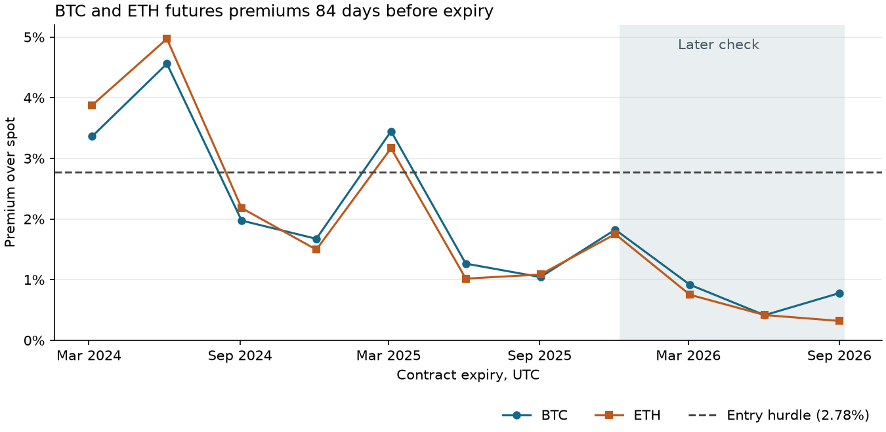

# Should Aahil Wave trade arbitrage?

**Keep a paper alert for wide BTC and ETH futures premiums.** The 84-day cash-and-carry rule earned 350.84 USDT after modeled costs on 10,000 USDT in 2024–25. Six hedges qualified across three quarterly expiries. The rule found no entry in the January–September 2026 check. In three public-book captures on November 11–12, 2026 UTC, none of 137 usable dated-futures observations cleared the capital hurdle. Cross-exchange spot arbitrage lost money after fees in all 116 usable route checks. These are simulated returns and observed quotes. Real fills and live P&L are unmeasured.

## The premium worth monitoring

Buy spot and sell the same quantity of a linear USDT future. If the spot sale at expiry matches the delivery index, the initial difference between futures sale and spot purchase is the gross payoff per coin. The actual payoff also includes the difference between the spot sale price and the settlement index. The entry premium is observable before submitting. Future fee notionals, simultaneous fills, margin needs and the price of the spot unwind remain uncertain. BIS research identifies leveraged demand and limited arbitrage capital as reasons such premiums can persist. [Crypto carry research](https://www.bis.org/publications/working-paper-1087-crypto-carry) · [Binance linear contract specifications](https://www.binance.com/en/support/faq/detail/3ae441db4ae740e19af3fe9228eb6619)

The rule reserves 5,000 USDT per asset and uses at most 40% per leg at the decision prices. It charges 10 basis points on spot purchases and sales, 5 on futures entry and delivery, and 2 of slippage on each of the three market trades. The entry must also cover a 4% simple annual capital charge on the entire sleeve for the holding period and an extra 5 bp of spot notional. These are explicit research assumptions. Four percent is a comparison rate, not an observed USDT deposit rate.

At 84 days those assumptions require approximately **2.78%** futures premium over spot. At seven days they require about **0.60%**. The historical signal compares completed bars, then uses the next five-minute close for entry. The live scanner compares the spot ask with the futures bids available for the same quantity, rounds to a common lot size and rejects stale quotes or inadequate displayed size. [Seven-day rules and dated 84-day follow-up](../dated-carry-plan.md) · [Historical implementation](../../dated_carry.py) · [Public quote monitor](../../carry_watch.py)



## Historical results

Each column starts with 10,000 simulated USDT. Both include fees and slippage. The second period uses later dates that have appeared in other repo research. It supplies a historical check rather than a prospective track record. A perpetual hedge earns signed funding and bears the change in the spot–perpetual price difference. Dated futures have a fixed delivery date and no periodic funding in this study.

| Strategy | Jan 2024–Dec 2025 net USDT | Jan–Sep 2026 net USDT |
| --- | ---: | ---: |
| Dated futures, seven-day premium rule | 0.00 | 0.00 |
| Dated futures, enter all seven-day opportunities | −116.87 | −40.15 to −38.44 |
| Dated futures, 84-day premium rule | +350.84 | 0.00 |
| Dated futures, enter all fillable 84-day opportunities | +579.91 | +12.83 to +14.14 |
| Perpetuals, enter on trailing funding | +187.10 | 0.00 |
| Perpetuals, continuously hedge eligible coins | +520.12 | +17.28 |
| Idle cash at zero yield | 0.00 | 0.00 |
| Illustrative 4% simple return on the entire account | +801.10 | +299.18 |

**Dated futures.** Seven days produced zero signals. The 84-day follow-up was specified after seeing the seven-day results. The high-premium entries were BTC and ETH for March 2024, June 2024 and March 2025. Both coins share market risk, so six winning hedges overstate the number of independent observations. The best expiry contributed 158.91 USDT. The other two contributed 191.93. Five-minute marked drawdown reached 1.38% despite every selected hedge closing positive. The gain exceeded a 4% charge on deployed sleeve-days by 71.81 USDT, but fell 450.25 short of a 4% return on the whole account because cash sat idle. [All quoted premiums](dated-opportunities.csv) · [Hedge ledger](dated-orders.csv) · [Totals and drawdown](dated-results.json)

The delivery API omitted September 2026 for both coins at retrieval. For eligible controls with missing settlement, bounds use the average of each minute's index low and high over the official settlement window, expanded by one price tick. Both September seven-day bounded trades were losses. For the 84-day control, BTC size exceeded the entry bar's total traded quantity and ETH had a bounded loss. The selective rules had already declined these entries on decision-time prices. The other published delivery prices were checked against the index window. Binance changed its settlement average from the last hour to the last half-hour in November 2024. [Settlement methodology change](https://www.binance.com/en-AU/support/announcement/detail/4bcabddf0e81423ebca242e185bf157d) · [Official settlement endpoint](https://github.com/binance/binance-futures-connector-python/blob/main/binance/um_futures/market.py)

**Perpetual funding.** Each of four coin sleeves starts with 2,500 USDT. Monthly membership uses lagged volume, spread and 1% depth. The selective rule uses only funding settled strictly before the decision, projects the prior 30 days' receipts over the next month and requires that projection to cover estimated turnover and capital costs. The passive control holds each eligible coin and nets quantity changes at rebalance. BTC, ETH and SOL supplied the passive positions. Gains and fees include idle sleeve capital in the return denominator. The selective rule produced nine positive episodes in development, across only 12 active coin-months, and no later positions. [Funding rule fixed before scoring](../perp-carry-plan.md) · [Monthly decisions](perp-months.csv) · [Round trips](perp-episodes.csv)

In the later check, passive carry earned **35.01 USDT** in funding and **0.33** from the basis, against **14.26** in fees and **3.80** in slippage. Net was **17.28**, or **0.17% over nine months**. Keeping every debit and halving positive funding credits turns that into **−24.93 USDT** at the same sizes. The descriptive seven-day block bootstrap interval for total net P&L is **−20.41 to +52.56 USDT**. The bootstrap uses joint daily portfolio changes and includes inactive days. Few trade episodes, changing funding regimes and shared coin exposures limit inference. [Results, stresses, bootstrap and price coverage](perp-results.json)

The simulation uses same-venue aligned five-minute spot and contract bars. A day missing from the June 2026 monthly perpetual mark-price archives was recovered from checked daily exchange archives. Margin checks use intrabar futures mark highs, cash remaining after the spot purchase and a 1% short-side maintenance stress. Perpetual sleeves can reallocate USDT between legs at monthly rebalance. Historical fees assume payment in quote currency or an equivalent fee reserve. Real fee tiers, partial fills, missed hedges, exchange solvency, USDT exposure and margin-transfer interruptions can materially change the result. [Binance public data archive documentation](https://github.com/binance/binance-public-data)

## Observed books

| Read-only check on Nov 11–12, 2026 UTC | Usable observations | Result |
| --- | ---: | --- |
| KuCoin ↔ Gate, BTC/ETH/SOL spot, roughly 1,000 USDT bought per comparison | 116 of 360 directed route checks | 35 positive gross spreads, zero positive after 10 bp taker fees per leg |
| Binance spot ask and December/March USDT futures bids, 5,000 USDT sleeve per comparison | 137 of 240 contract checks | Zero cleared the 4% capital charge plus buffer |

For cross-exchange spot, even the best displayed route lost **1.85 USDT** after fees. Its fee break-even was only **0.74 bp per leg** before any additional latency, inventory rebalancing or transfer expense. Observations came from three bounded sessions, including a gap in the first. Opposite directions and repeated quotes are correlated. The scanner assumes the buy venue already has USDT and the sell venue already has the coin. A withdrawal after seeing the quotes would introduce a different holding period and price exposure. [Session summaries](quote-sessions.json) · [Scanner and fee controls](../../spot_arb_scan.py)

In the November 12 capture the March BTC future offered a conditional median **32.61 USDT on 5,000 reserved for about 134 days**, or **1.78% simple annualized**. That assumes a spot unwind at the settlement index and fees on terminal notionals approximated by current spot. The 4% capital charge alone was about **73.40 USDT**. These were quotes on live order books, with neither an entry fill nor a future payoff observed. The roughly 43-day and 134-day live maturities illustrate the available terms, separate from the 84-day historical schedule. The first capture rejected 88 stale contract comparisons. The second used a lower-bandwidth futures depth stream and the same time and size checks. The next-day capture admitted another 47 of 48 contract checks. All three sessions are included. [Observed books and conditional estimates](quote-sessions.json) · [Spot stream fields](https://github.com/binance/binance-spot-api-docs/blob/master/web-socket-streams.md)

## Run the studies

From the repository root:

```sh
python -m pip install -r requirements-carry.txt
python perp_carry.py
python dated_carry.py
python spot_arb_scan.py --rounds 24 --interval 3
python carry_watch.py --rounds 24 --interval 2
python -m unittest test_carry
```

The historical scripts retrieve public inputs, cache them under `data/`, and write the reviewed results under `research/carry/`. The scanners save timestamped local observations under `data/spot-arb/` and `data/carry/quotes/`. Re-running a scanner samples new books. The published settlement response is cached with its retrieval time. The plot can be regenerated with `python plot_carry.py` after the dated study. The Aahil Wave entry model and its sealed prospective rules remain a separate experiment.
