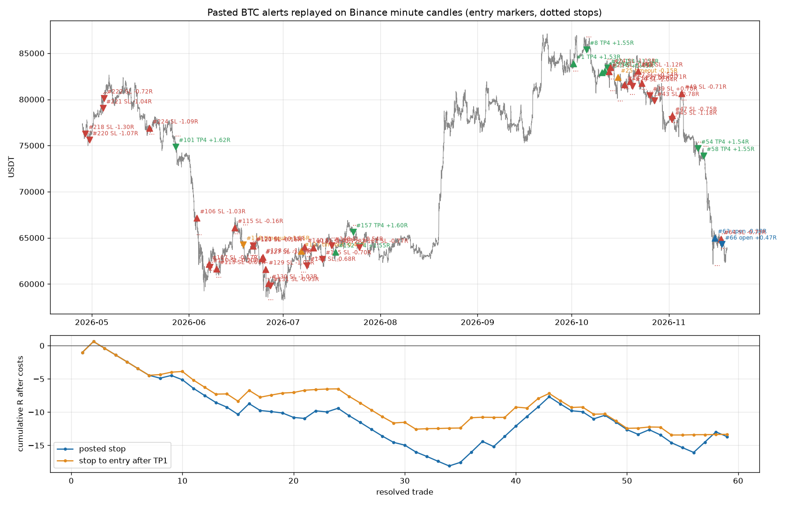

# Do the pasted four-target BTC alerts make money?

**Not on these 50 alerts.** Two pasted runs of a Discord channel (May 27–July 25 and October 1–November 19, 2026) were replayed on Binance BTCUSDT perpetual one-minute candles. The posted limit entry, stop and four targets were used as written.
- **Resolved trades:** 44 of the 46 fills resolved. Each lost 0.076R on average after fees, with a 95% bootstrap interval of −0.37R to +0.24R.
- **Win rates:**
  - **Channel-style count (target 1 before the exit):** 31 of 44 trades, or 70%.
  - **Trades that made money:** 15 of 44, or 34%.
- **Unreported outcomes:**
  - 31 trades hit their full stop. No stop was ever posted.
  - 21 of those stopped trades had already been announced as a target hit.

This is a retrospective check of copied messages, not a record of anyone's account. [Replay code](../../czar_audit.py) · [Tests](../../test_czar_audit.py) · [Every alert](replay.csv) · [Totals](results.json)

## Why a 70% hit rate can still lose

- **Target 1 is very close.** Its median distance from entry is **0.30R**, meaning 0.3 times the stop distance.
- **Payoffs per trade:** with a quarter of the position closed at each target, reaching all four averages about +1.5R before costs. Target 1 followed by the stop nets about −0.7R, and a straight stop is −1R. "TARGET 1 HIT" is therefore the most frequent post even when the trade ends at a loss.
- **Stop size:** the median stop was 1.16% from entry. At the posted 20x leverage that is about 23% of the margin per stopped trade. If every trade used the same margin, the 44 resolved trades together lost **1.78 times** that margin after fees.

## Replay rules

- **Display time:** the Discord times were read as UTC+4. That offset put 79% of the 78 reported target hits within 30 minutes after the level actually traded, against at most 67% for any other offset from −6 to +6 hours.
- **Entry:** each alert starts at the next full minute. The entry is a limit that fills when price trades back to it, and it lapses after 24 hours.
- **Exits:**
  - A quarter of the position closes at each target.
  - The stop takes priority whenever stop and target trade in the same minute.
  - Targets count only from the minute after the fill.
  - A position still open after seven days is closed at the close.
- **Costs:** 2 bp maker on the entry and targets, and 5 bp taker plus 1 bp slippage on stops and timeouts. Funding is ignored.

| Variant | Resolved | Mean R per trade | 95% interval | Profitable | Full stops |
| --- | ---: | ---: | --- | ---: | ---: |
| Posted limit entry and stop | 44 | −0.076 | −0.37 to +0.24 | 15 | 31 |
| Move stop to entry after target 1 | 44 | −0.113 | −0.34 to +0.11 | 28 | 13 |
| Market entry at the alert's next minute | 47 | +0.003 | −0.29 to +0.30 | 19 | 30 |

**Hits before entry.** 16 of the 78 reported hits were posted before the limit entry had traded. Three alerts never filled at all within 24 hours. The channel appears to score targets from the alert price, which is why the market-entry variant is included. It also shows no edge.



## Limits

- **Assumed exits:** the channel never states partial exits, stop moves or cancellations. The rules above are assumptions, and the stop-to-entry variant shows that one common alternative also loses.
- **Ambiguous messages:**
  - One alert had no post time.
  - On June 22 a target 3 hit and a target 1 hit were posted in the same minute, for alerts on opposite sides. They are assigned to the short and the long respectively.
- **Sample:** the two pastes may not be the channel's complete history.
- **Fills:** minute candles cannot show queue position, partial fills or the exact trigger price used for stops.

```
python czar_audit.py
```
