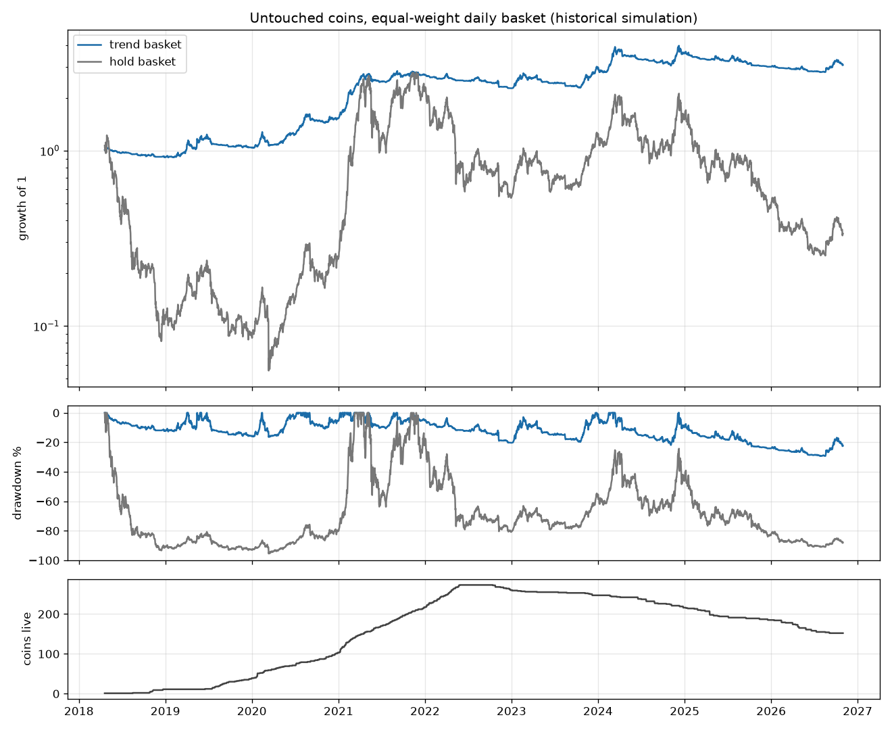

# Does the trend rule hold up on coins it never saw?

**Yes, by the pre-registered test, with a weak recent stretch.** The unchanged rule ran on 278 Binance USDT spot coins that no earlier study in this repo had touched, including 126 that were delisted or stopped trading before the end. An equal-weight daily basket of the trend sleeves had a Sharpe of **0.89** from April 2018 to October 2026, against **0.29** for holding the same coins.
- **Sharpe difference:** +0.60, with a 95% interval of **+0.14 to +1.02**. Its lower bound is above zero, so the study passes.
- **Worst drawdown:** −29% for the trend basket, against −95% for holding.
- **Since 2024:** the trend basket earned only **+1.8% a year** while holding lost 36% a year. That beats holding but trails a cash yield.

This is a historical simulation, not a record of live or paper trading. [Rules fixed and committed before scoring](../trend-fresh-plan.md) · [Code](../../trend_fresh.py) · [Tests](../../test_trend_fresh.py) · [Per-coin results](coins.csv) · [Totals](results.json)

| April 2018–October 2026 | Sharpe | CAGR | Volatility | Max drawdown |
| --- | ---: | ---: | ---: | ---: |
| Trend basket | 0.89 | +14.1% | 16.4% | −29.3% |
| Hold basket | 0.29 | −12.0% | 84.4% | −95.4% |

| Since January 2024 | Sharpe | CAGR | Max drawdown |
| --- | ---: | ---: | ---: |
| Trend basket | 0.19 | +1.8% | −29.3% |
| Hold basket | −0.30 | −36.1% | −88.1% |

- **Per coin:** trend had the higher Sharpe on 198 of 278 coins (one-sided sign test p ≈ 5 × 10⁻¹³). Coins move together, so that count overstates the number of independent tests.
- **Since-2024 interval:** the Sharpe difference was +0.50, with a 95% interval of −0.40 to +1.30.



## How it was run

- **Universe:** every Binance USDT spot pair whose first monthly archive is December 2021 or earlier. Excluded before scoring were stablecoin and fiat bases, leveraged tokens, the nine coins studied earlier, and coins with under a year of data after warm-up.
- **End of a coin's sample:** a delisting, a missing day or an invalid candle ends that coin's sleeves at the last valid close.
- **Rule:** the same as [trend-plan.md](../trend-plan.md):
  - signal from 20/60/120-day returns;
  - 40% volatility target over 30 days, capped at 1;
  - 0.10 rebalance band;
  - trades at the next open, spot only, no leverage.
- **Costs:** 10 bp fee plus 10 bp slippage per side. That slippage is five times the BTC/ETH assumption.
- **Basket:** averages each day's returns over the coins live that day. The bootstrap uses 60-day moving blocks, 5,000 resamples and seed 20261119.

## Limits

- **Thin early sample:** only 1 to 10 coins were live before 2019, rising to 273 in mid-2022.
- **Real costs on small coins:** the 10 bp slippage is a flat assumption. Small coins can cost more to trade, and their prices can gap past any level.
- **Cash tied up:** the trend basket held cash much of the time, which explains most of its smaller drawdowns. Cash earns zero here.
- **Recent weakness:** since early 2025 the trend basket has drifted down from its high to a −29% drawdown. Most of its outperformance came from avoiding the 2018, 2022 and 2025–26 crashes, not from catching rallies.

```
python -m unittest test_trend_fresh
python trend_fresh.py
```
