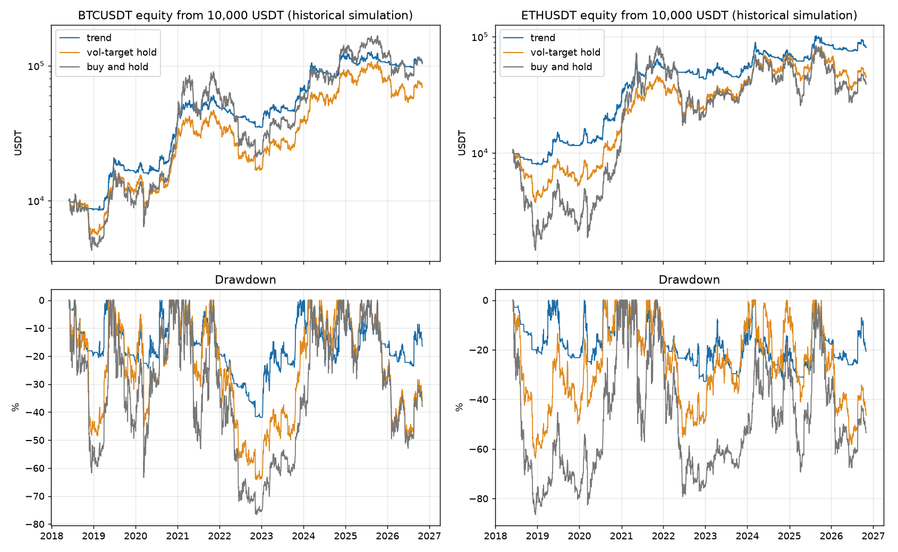
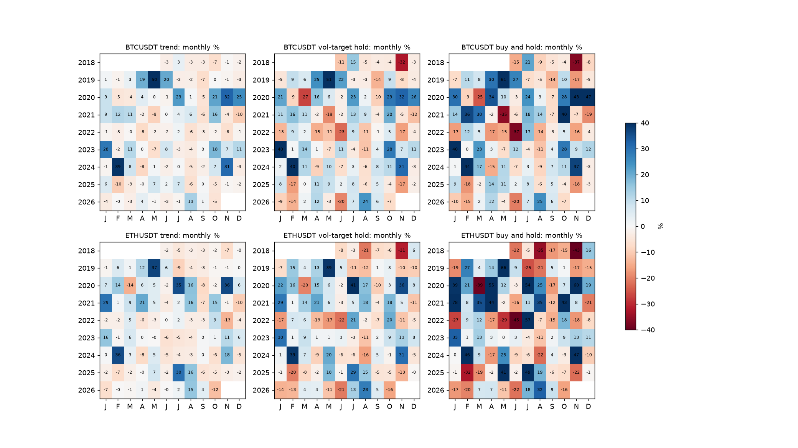

# Does volatility-targeted trend beat holding BTC and ETH?

**Not by the pre-registered test.** In a historical simulation of Binance spot BTCUSDT and ETHUSDT daily candles (first trade 2018-06-01, data through 2026-10-31), a three-lookback trend rule with volatility scaling had a higher Sharpe than buy-and-hold and much shallower drawdowns. The 95% interval for the Sharpe difference still includes zero for both coins, so the plan's pass criterion fails. These are simulated returns. No order was placed and there is no live track record. [Rules fixed before scoring](../trend-plan.md)

## Rule as implemented

- Signal at each daily close: the share of the 20-, 60- and 120-day returns that are positive (0, 1/3, 2/3 or 1). Scale: 40% target divided by the annualised sample standard deviation (ddof 1, 365 days) of the last 30 daily log returns, capped at 1. Target weight is signal times scale. Spot only, no leverage, no shorting.
- The weight is decided from closes up to and including day t and traded at the open of day t+1, only if it differs from the weight held at the close of day t by more than 0.10. The equity path is marked at daily closes.
- Costs: 10 bp fee plus 2 bp slippage per side on traded notional. Idle cash earns zero. Each coin is a separate 10,000 USDT account with no withdrawals.
- Controls: buy-and-hold (fully invested from the first trade) and a volatility-targeted hold (same scale, signal fixed at 1, same band and costs).
- Warm-up is 150 days (120 for the longest lookback plus 30 for volatility) from 2018-01-01, so the first decision is the 2018-05-31 close and the first trade is the 2018-06-01 open.

## Results, 2018-06-01 to 2026-10-31

| Coin | Rule | CAGR | Volatility | Sharpe | Max drawdown | Invested | Fees + slippage USDT | Final USDT |
| --- | --- | ---: | ---: | ---: | ---: | ---: | ---: | ---: |
| BTC | Trend | 32.3% | 28.0% | 1.14 | −41.9% | 76% | 10,161 | 105,847 |
| BTC | Vol-target hold | 25.8% | 42.8% | 0.75 | −64.2% | 100% | 755 | 69,151 |
| BTC | Buy and hold | 32.0% | 61.4% | 0.76 | −76.6% | 100% | 12 | 103,526 |
| ETH | Trend | 28.1% | 29.9% | 0.98 | −32.8% | 76% | 6,552 | 80,734 |
| ETH | Vol-target hold | 19.4% | 44.6% | 0.62 | −63.7% | 100% | 976 | 44,545 |
| ETH | Buy and hold | 17.5% | 82.0% | 0.61 | −86.5% | 100% | 12 | 38,991 |

Fees and slippage are in USDT on compounding accounts, so they look large against a 10,000 start. Trend turnover is about 18 times average equity per year for BTC and 14 for ETH, against 2 to 3 for the volatility-targeted hold. Trend made 579 trades on BTC and 526 on ETH. Completed position episodes won 26% of the time on BTC (101 episodes) and 27% on ETH (73), reported for reference only. Trend profits come from a few large wins.

**Sharpe difference, 60-day moving-block bootstrap, 5,000 resamples, seed 20260101, paired daily returns**

| Coin | Trend − buy and hold | Trend − vol-target hold |
| --- | ---: | ---: |
| BTC | +0.38 (−0.08 to +0.80) | +0.39 (−0.05 to +0.80) |
| ETH | +0.37 (−0.07 to +0.79) | +0.36 (−0.08 to +0.77) |

**2024-01 onward** (base is the 2023-12-31 close)

| Coin | Rule | CAGR | Sharpe | Max drawdown |
| --- | --- | ---: | ---: | ---: |
| BTC | Trend | 18.2% | 0.78 | −23.6% |
| BTC | Buy and hold | 23.9% | 0.69 | −53.0% |
| ETH | Trend | 15.0% | 0.66 | −31.9% |
| ETH | Buy and hold | −0.4% | 0.33 | −67.6% |

Trend earned less than holding BTC since 2024 but with less than half the drawdown. The subperiod Sharpe difference intervals are wide: BTC +0.09 (−0.66 to +0.74) and ETH +0.33 (−0.50 to +1.11) against buy-and-hold. Calendar-year returns, monthly returns, vol-target numbers and the since-2024 costs are in `results.json`.

## Verdict against the plan

- Sharpe difference interval above zero for at least one coin: **fail**. Lower bounds are −0.08 (BTC) and −0.07 (ETH); about 94-95% of resamples are above zero.
- 2024-01 onward Sharpe not below buy-and-hold for either coin: **pass** (0.78 vs 0.69 and 0.66 vs 0.33).
- The trend rule therefore **fails** the pre-registered criteria. Most of the Sharpe gain comes from avoiding the 2018, 2022 and 2026 drawdowns, which is few independent episodes.





## Robustness checks run after scoring

These are post-hoc diagnostics. They do not change the rule or the verdict above. [Script](../../trend_robustness.py) · [All runs](robustness.json)

**Nearby parameters.** Lookbacks of (10, 30, 60), (20, 60, 120) and (40, 120, 240) days were crossed with volatility targets of 25%, 40% and 60% and bands of 0.05, 0.10 and 0.20. Across all 27 combinations the BTC Sharpe ranged from 1.05 to 1.29 against 0.76 for holding, and ETH ranged from 0.86 to 1.15 against 0.61. The chosen settings sit near the middle of each range rather than at the top.

**Coins the rule was not designed on.** The identical rule beat buy-and-hold's Sharpe on all seven, and roughly halved the worst drawdown on each:

| Coin | First trade | Trend Sharpe | Hold Sharpe | Trend max DD | Hold max DD | Sharpe difference 95% |
| --- | --- | ---: | ---: | ---: | ---: | ---: |
| BNB | 2018-06 | 1.03 | 0.97 | −37% | −76% | −0.30 to +0.49 |
| XRP | 2018-10 | 0.65 | 0.60 | −42% | −83% | −0.38 to +0.45 |
| ADA | 2018-09 | 0.99 | 0.59 | −43% | −95% | +0.03 to +0.76 |
| LTC | 2018-06 | 0.54 | 0.34 | −41% | −89% | −0.26 to +0.56 |
| LINK | 2019-07 | 0.74 | 0.67 | −46% | −90% | −0.31 to +0.42 |
| DOGE | 2019-12 | 1.07 | 0.79 | −30% | −92% | −0.07 to +0.59 |
| SOL | 2021-01 | 1.40 | 1.06 | −32% | −96% | −0.14 to +0.93 |

**Nine-coin basket.** Over the 2,101 days when all nine coins traded, an equal-weight basket of the nine trend sleeves had a Sharpe of 1.02, CAGR 21.3% and worst drawdown −28%. The nine buy-and-hold sleeves had 0.76, 32.6% and −79%. The Sharpe difference was +0.27 with a 95% interval of −0.13 to +0.78, positive in 92% of resamples. The coins move together, so nine coins are much less than nine independent tests.

**Reading.** The improvement is consistent in direction across parameters and coins, and it mostly comes from cutting drawdowns. It earns less than holding in strong bull runs. No single test clears a 95% bar, so this remains a risk-reduction overlay worth paper-tracking, not a proven source of excess return.

## Forward paper record

The paper record started at the 2026-11-17 UTC close with 10,000 simulated USDT per coin. Both coins were at signal 0/3, so the first decision was to hold no position. Each run replays the frozen rule from that start on closed Binance daily candles. Trades fill at the next daily open with the same 10 bp fee and 2 bp slippage. Rerunning on the same day adds no ledger row and posts nothing new. Nothing in this path can place an order.

Each daily post shows the target and held weight, any trade for the next open, paper equity against holding since the start, and the three trend levels. Those are the prices tomorrow's close is compared against, so a close below a level turns that lookback off and a close above turns it on. They play the role a stop or entry line would in a discretionary signal. The rule has no fixed take-profit or stop-loss.

```
python trend_paper.py
```

The ledger, state and daily charts are written to `data/trend-paper/` (gitignored). To post to Discord, create a channel webhook and set `DISCORD_WEBHOOK_URL` before running. Without it the script saves the chart and message instead. Run it once a day shortly after 00:00 UTC.

## Choices where the plan was silent

- Binance monthly archives end 2026-10; the data end there to match the plan, and the November partial month is not used. The 2026 calendar year is therefore ten months.
- Weight drift: the band compares the target with the weight after that day's close move. Because exits to zero are only traded when the held weight exceeds 0.10, small residual positions can persist.
- Buys are capped so cash cannot go negative. Fees and slippage are deducted from cash at the open. Time invested counts closes with a held weight above zero.
- Volatility uses the sample standard deviation; a zero-variance window gives a scale of 1. Bootstrap intervals use the 2.5th and 97.5th percentiles of resampled differences.
- The full-run bootstrap uses all days from the first trade; the 2024 subperiod interval is a separate resample of the later days.

## Reproduce

```
python -m unittest test_trend
python trend.py
python trend_live.py
```

`trend.py` downloads [Binance public monthly daily-kline archives](https://github.com/binance/binance-public-data) into `data/trend/` (gitignored), checks continuity and OHLC sanity, and writes `results.json`, `daily.csv` (target weight decided at each close, weight held at the close and equity per rule), and both PNGs here. Open times switch from milliseconds to microseconds in 2025-01 and are normalised. `trend_live.py` reads public daily candles and prints today's target weight per coin for forward paper tracking. It never places orders.
